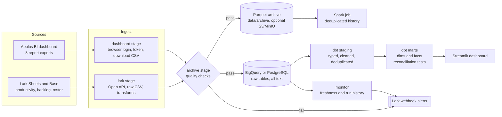

# cs-ops-etl-pipeline

Daily ELT for the TikTok Shop customer service operations reports. It pulls data from the BI dashboard and from Lark, keeps a Parquet archive, loads the raw data into **BigQuery or PostgreSQL**, models it with dbt (staging, dimensions, facts, reconciliation tests) and serves a dashboard, with monitoring and alerts around every step.



More diagrams (daily schedule, how one report is loaded, backfill, dbt layers) in [docs/workflow.md](docs/workflow.md).

## What this covers

| Area | In this repo |
|------|--------------|
| ETL / ELT pipelines | Two source systems (the Aeolus export API with browser-captured token, the Lark Open API for Sheets and Base), Parquet archive, loads into BigQuery or PostgreSQL, dbt transformations. Adding a source is a JSON config plus, for a new API, one client. |
| Warehouse and modelling | Raw / staging / marts layers, star schema with defined grain and keys, incremental facts, partitioned and clustered BigQuery tables. See [docs/data-model.md](docs/data-model.md). |
| Duplicates | Handled in staging (latest load wins per business key, exact copies collapsed); loader replaces whole date windows so it cannot create them. |
| Data quality and reconciliation | Loader guards, dbt tests (keys, grain, relationships, ranges), raw-to-staging and mart-to-staging reconciliation, source freshness, row-limit detection. |
| Incident handling | [docs/runbook.md](docs/runbook.md): symptom, cause, action. |
| Automation and monitoring | Prefect flow (retries, timeouts, dependency order), `pipeline_runs` history, freshness monitor, Lark alerts. |
| Cost and performance | Partition pruning, clustering, `insert_overwrite`, per-query byte cap, dry-run estimate. See [docs/bigquery.md](docs/bigquery.md). |
| Security | Secrets handling, least-privilege IAM proposal, hashed agent keys. See [docs/security.md](docs/security.md). |
| Documentation and code management | Workflow diagrams, runbook, data model, CI (lint, tests, warehouse build, BigQuery SQL check). |

Scope: the sources are the customer service reports above. There are no e-commerce platform, POS, OMS/WMS or accounting connectors here. BigQuery support is tested with a fake client and offline SQL rendering, not yet against a real project (details in [docs/bigquery.md](docs/bigquery.md)).

Stages, each runnable on its own:

| Stage | What it does |
|-------|--------------|
| `dashboard` | Logs in with a real browser (Selenium) to capture the Open-Api-Token, then downloads 8 report CSVs through the export endpoint. Date filters are rewritten on every run to cover the last N weeks. |
| `lark` | Reads sheets and a Base table through the Lark Open API, dumps them to raw CSV, and applies the cleanup rules for the productivity and backlog sheets. |
| `archive` | Checks the newest CSV of every source (not empty, no sudden row-count drop versus the previous day), then writes it as date-partitioned Parquet (`data/archive/<source>/dt=YYYY-MM-DD/`). Optionally uploads to S3 / MinIO. |
| `database` | Loads the newest CSV for each source into its table, in one transaction. Dashboard sources are loaded **incrementally** (only the downloaded date window is replaced, older history is kept); Lark sources are full snapshots and replace the table. See below. |
| `backfill` | Loads years of history month by month, resumable. See below. |
| `monitor` | Checks that every table has recent data and a recent successful load; posts to Lark if not. |

## Setup

Python 3.12+ and Chrome are required.

```bash
python -m venv .venv
source .venv/bin/activate        # Windows: .venv\Scripts\activate
pip install -r requirements.txt

cp .env.example .env             # then fill it in
```

If `AEOLUS_CHROME_DRIVER_PATH` is empty or points to a driver that does not match your Chrome, Selenium Manager downloads a matching one.

The Lark source configs and the dashboard payloads in this repo have their IDs blanked out (`<SPREADSHEET_TOKEN>`, `reportId: 0`, ...). Put your own values in before running.

## Usage

```bash
# everything, in order: dashboard -> lark -> archive -> database
python main.py

# one stage
python main.py --module dashboard
python main.py --module lark
python main.py --module lark --type sheet_raw
python main.py --module lark --source ProductivityDataReportRaw
python main.py --module archive

# database: create missing tables once, then load
python main.py --module database --action init
python main.py --module database --action load
python main.py --module database --source ticket_details
```

With `--module all` the database load is skipped if any earlier stage failed (including a failed quality check), so a half-downloaded day never overwrites good data.

Check the database credentials without running anything else:

```bash
python check_db_connection.py
```

## Choosing the warehouse

PostgreSQL is the default. For BigQuery set `WAREHOUSE=bigquery` (plus `BQ_PROJECT`, `BQ_DATASET`, optionally `BQ_LOCATION` and a `BQ_MAX_BYTES_BILLED` cap) and use the same commands; tables are partitioned by date and clustered, windows are replaced in one transaction, and dbt runs with `--target bigquery`. Setup, cost notes and what has been tested: [docs/bigquery.md](docs/bigquery.md).

## Incremental loading

The dashboard export only covers a rolling window (about 5 weeks), but the tables hold years of history. A plain truncate-and-reload would throw the history away on every run, so dashboard sources use `"load_mode": "incremental"` with a `date_column` in `configs/database/sources/*.json`:

1. The downloader writes a sidecar `<file>.csv.meta.json` with the date range it asked for.
2. The loader copies the CSV into a temp table, deletes rows of the target table inside that date range, and inserts the new rows. Everything in one transaction.
3. Guards that abort the load and leave the table untouched: empty CSV, rows with a missing date, rows outside the downloaded window, and a window that would shrink by more than `LOAD_MAX_SHRINK_RATIO` (default 0.5), which usually means a partial download.

The date column is indexed on first load. Because the raw tables store everything as text, windows are compared as ISO date strings, so the plain btree index is used. Sources without `load_mode` keep the old truncate-and-reload behaviour (Lark sheets, roster).

The export also stops silently at 1,000,000 rows; the downloader now treats a file that reaches the limit as an error and deletes it instead of loading a truncated report.

## Backfill

```bash
# everything from 2024 up to the start of the rolling window, one month at a time
python main.py --module backfill --from 2024-01-01 --to 2026-09-26

# a single report, weekly chunks
python main.py --module backfill --source ticket_details --from 2025-01-01 --to 2025-12-31 --chunk week
```

Each chunk is downloaded, loaded incrementally and archived as Parquet. A chunk that hits the row limit is split in half automatically. Finished chunks are recorded in `data/backfill_state.json`, so after a failure (expired session, network) running the same command continues where it stopped. Chunk files are deleted after loading unless `--keep-files` is given. After a backfill, rebuild the incremental dbt facts once with `dbt build --full-refresh`.

## Monitoring

- Every database load is written to `<DB_SCHEMA>.pipeline_runs` (stage, source, status, rows, duration, error, details).
- `python main.py --module monitor` reports sources whose table is missing, whose newest date is more than `max_lag_days` old (per source in the config, default 3), or with no successful load in the last `MONITOR_MAX_LOAD_AGE_HOURS` (default 36). Problems are sent to the Lark webhook and make the command exit non-zero.
- In the Prefect flow, a task that still fails after its retries posts to the same webhook, and `monitor` runs as the last task.

## Dashboard

A Streamlit report on top of the marts: KPI cards with change versus the previous period and adjustable targets, productivity by week, segment, tenure, tier and team, quality (CSAT, FCR, 24h resolution), backlog and ageing, forecast versus actual with staffing, an agent scorecard, and a data-freshness page. Agents are shown by hashed id unless `SHOW_AGENT_EMAIL=1`.

```bash
pip install -r requirements-app.txt
streamlit run app/streamlit_app.py          # uses the DB_* variables
# or: docker compose up app                 # http://localhost:8501
```

Without `DB_HOST` the app starts in **sample mode** on bundled synthetic data, so it runs anywhere with no database and this repository can be added to Streamlit Community Cloud as it is (main file `streamlit_app.py`). See [docs/demo.md](docs/demo.md).

## Try it without real data

`scripts/make_demo_data.py` writes synthetic CSVs with the same columns as the real dashboard exports, so everything after the download step can be run locally:

```bash
docker compose up -d postgres                     # or any PostgreSQL 14+
printf 'DB_HOST=localhost\nDB_NAME=warehouse\nDB_USER=etl\nDB_PASSWORD=etl_local\nDB_SSLMODE=disable\nDB_SCHEMA=Service\n' > .env
export DB_HOST=localhost DB_NAME=warehouse DB_USER=etl DB_PASSWORD=etl_local DB_SSLMODE=disable DB_SCHEMA=Service

python scripts/make_demo_data.py --days 14 --agents 30
PGPASSWORD=etl_local psql -h localhost -U etl -d warehouse -c 'create schema "Service"'

for s in cph_details ticket_details csat_details ontime_attendance backlog_details fc_actual_details; do
  python main.py --module archive  --source $s
  python main.py --module database --action init --source $s
  python main.py --module database --action load --source $s
done

pip install -r requirements-dbt.txt
dbt build --project-dir dbt --profiles-dir dbt
streamlit run app/streamlit_app.py
```

CI runs exactly this on every push, followed by the integration tests in `tests/integration` (incremental load, backfill, monitoring, dashboard).

## Transformations (dbt)

Raw tables are all TEXT and keep the exports' quirks (`''` and `'NULL'` for missing, `1970-01-01` for "no date", daily `Sum` rows in attendance). `dbt/` cleans and models them:

```
raw (schema Service) -> staging (views, typed + cleaned) -> marts (tables)
```

| Model | Grain |
|-------|-------|
| `dim_date`, `dim_agent` | day; agent (latest tier / tenure / team, keyed by hashed e-mail) |
| `fct_productivity_daily` | agent x day x segment x skill group (CPH, online rate, occupancy) |
| `fct_attendance_daily` | agent x day (shifts, late, on-time rate) |
| `fct_tickets_daily` | create date x skill group x user type x channel (volume, FCR, resolution time) |
| `fct_csat_daily` | date x skill group x channel (CSAT = share of 4-5 scores) |
| `fct_backlog_daily`, `fct_forecast_vs_actual` | day x user type; day x skill group |
| `mart_agent_weekly` | agent x week (Sunday start): productivity + attendance + CSAT |

`fct_productivity_daily`, `fct_attendance_daily`, `fct_tickets_daily` and `fct_csat_daily` are incremental: each run rebuilds the last `lookback_days` days (default 45, `--vars '{lookback_days: 60}'` to change) and leaves older history alone. Run `dbt build --full-refresh` after a backfill or when you change a model. A group that disappears from the source inside the lookback window stays in the fact until the next full refresh.

Staging removes duplicates (latest load wins per ticket, exact copies collapsed). Tests cover keys, grain uniqueness, relationships between facts and dimensions and value ranges, plus reconciliation (`dbt/tests/reconciliation`): facts must match staging totals, no more than 1% of raw rows may disappear in staging, and duplicates in raw are reported. `dbt source freshness` warns after 2 days without a load. The models run on PostgreSQL and BigQuery through adapter-dispatched macros (`dbt/macros`). Connection settings come from the same `DB_*` variables as the pipeline. Marts are written to `staging` / `marts` schemas in the same database.

## Long-term history (Spark)

Each daily download covers only a rolling ~5-week window, so the same business date shows up in many archived snapshots, sometimes with corrected numbers. `spark/productivity_history.py` rebuilds a clean history from the Parquet archive:

1. reads every `dt=` snapshot of `cph_details`,
2. keeps the row from the newest snapshot for each agent / date / segment / skill group (late corrections win),
3. writes `data/lake/productivity_history/` (partitioned by month), `agent_weekly_trend/` (weekly CPH with a rolling 4-week average) and `tenure_monthly/` (CPH by tenure band).

```bash
pip install -r requirements-spark.txt      # needs Java 17+
python -m spark.productivity_history --archive-dir data/archive --out-dir data/lake
```

At the current volume (a few hundred thousand rows a day at most) plain pandas would also do the job; the point of Spark here is that the history keeps growing and the dedupe-by-latest-snapshot step scales with it.

## Scheduling with Prefect

`flows/cs_ops_etl.py` is the daily flow (07:00, Asia/Ho_Chi_Minh): `dashboard` and `lark` in parallel, then `archive`, then `load_postgres`, then `dbt_build`, then `monitor`; `spark_history` runs next to the load. Each task runs `python main.py --module ...` (or dbt / the Spark job) and streams its output into the Prefect log, so a failed task can be reproduced by hand. A task whose upstream failed does not run. Tasks retry twice with a 10 minute delay and have a timeout.

```bash
pip install -r requirements-prefect.txt
python -m flows.cs_ops_etl --once        # run the whole flow now, no server needed

# scheduled: the server has to be running, otherwise Prefect cannot schedule
prefect server start                     # terminal 1, UI on http://localhost:4200
export PREFECT_API_URL=http://127.0.0.1:4200/api
python -m flows.cs_ops_etl               # terminal 2: registers the daily deployment and serves it
```

A local stack (PostgreSQL, MinIO, Prefect server, the scheduled flow, dashboard) is defined in `docker-compose.yml`:

```bash
cp .env.example .env     # fill in the Aeolus / Lark / Outlook values
docker compose up --build
# Prefect UI: http://localhost:4200   MinIO console: http://localhost:9001   Dashboard: http://localhost:8501
```

The image ships Chromium and runs the browser step headless (`AEOLUS_HEADLESS=true`). The first login may need an interactive session to get past MFA; after that the profile under `data/` keeps the session. The compose file has not been run end to end against the real Aeolus login, so expect to adjust that part.

## Configuration

Everything that changes between sources lives in JSON under `configs/`:

```
configs/
  dashboard/sources/   one file per report: endpoint, payload, output name, dynamic_date
  lark/sheets/         sheet_raw sources (spreadsheet token, tab, column range)
  lark/base/           Base table sources (app token, table, field list)
  lark/transforms/     raw CSV -> cleaned CSV
  database/sources/    CSV file pattern -> target table
  database/settings.json
```

Adding a report is mostly a new JSON file. For a dashboard report, export it once from the browser, copy the request payload into a new file in `configs/dashboard/sources/`, and set `dynamic_date.field_id` to the date field you want the pipeline to move forward each run. For the database, add a matching file in `configs/database/sources/` with the table name and a glob for the CSV.

Table names currently used: `tickets`, `tqm`, `csat`, `im`, `attendance`, `forecast_actual`, `productivity_daily`, `backlog_daily`, `productivity_hourly`, `backlog_hourly`, `roster`. They are created in the schema from `DB_SCHEMA` (default `Service`).

## Layout

```
main.py                     entry point / CLI
check_db_connection.py      connection and privilege check
modules/
  core/                     .env loader, config validation
  dashboard/                auth (Lark + Outlook OTP), browser session, downloader, backfill, notifier
  lark/                     API clients, raw download, transforms
  storage/                  quality checks, Parquet archive, S3 upload
  database/                 connection, CSV profiling, incremental/replace loading
  monitoring/               run history, freshness checks
  warehouse/                BigQuery loader and runner
spark/                      history rebuild job (PySpark)
dbt/                        staging + mart models, macros, tests
app/                        Streamlit dashboard (PostgreSQL or bundled sample data)
scripts/                    synthetic data generator, BigQuery SQL check
docs/                       workflow, data model, runbook, security, BigQuery
flows/                      Prefect flow
Dockerfile (pipeline + Prefect), Dockerfile.app (dashboard), docker-compose.yml
tests/                      pytest (tests/integration needs PostgreSQL)
```

## Notes

- Failures are reported to a Lark webhook if `LARK_WEBHOOK_URL` is set. Tokens, cookies and passwords are masked before anything is sent.
- Download retries use backoff, and a 401/403 triggers one re-login before giving up on that report.
- Logs go to `logs/dashboard_pipeline.log`; downloaded CSVs to `downloads/`. Both are git-ignored, since they contain employee data.
- The browser profile in `data/` keeps the login session between runs. Also ignored.

## Development

```bash
pip install -r requirements-dev.txt
ruff check .
pytest
```

dbt models are exercised by the `warehouse` CI job (see above).

`tests/integration` runs against a real PostgreSQL when `DB_HOST` is set (otherwise skipped). The BigQuery loader is tested against a recording fake client, and `scripts/check_bigquery_sql.py` renders every dbt model for BigQuery offline and checks the SQL. The unit tests cover the pure helpers (env/config parsing, date-window calculation, header and identifier normalisation) and the Parquet archive and quality checks. The Prefect flow is tested with the stage runner replaced by a recorder (ordering and failure propagation) plus a real-subprocess test of the runner. The download and database stages need real credentials and are not covered.

## License

MIT, see [LICENSE](LICENSE).
