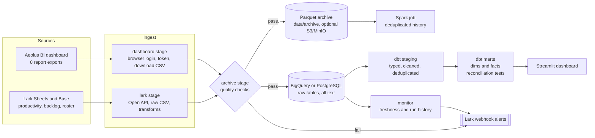
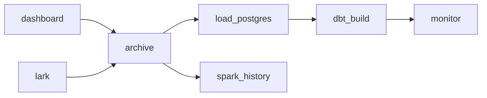
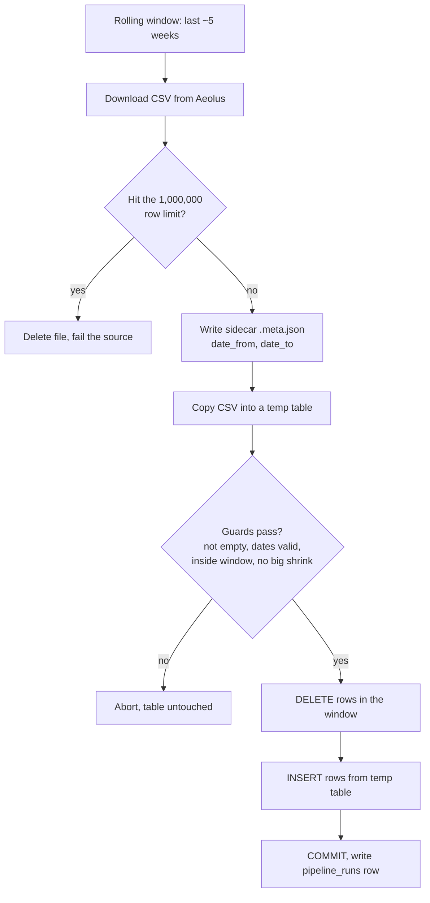
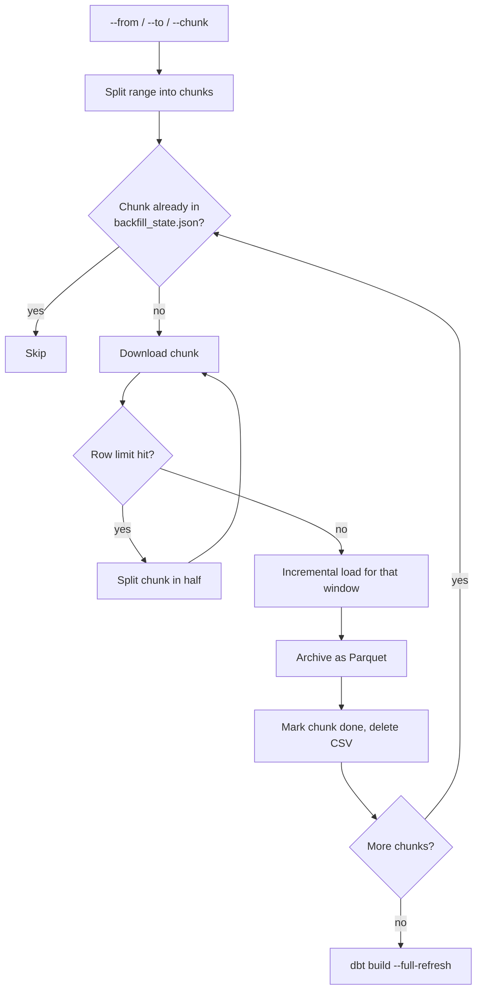
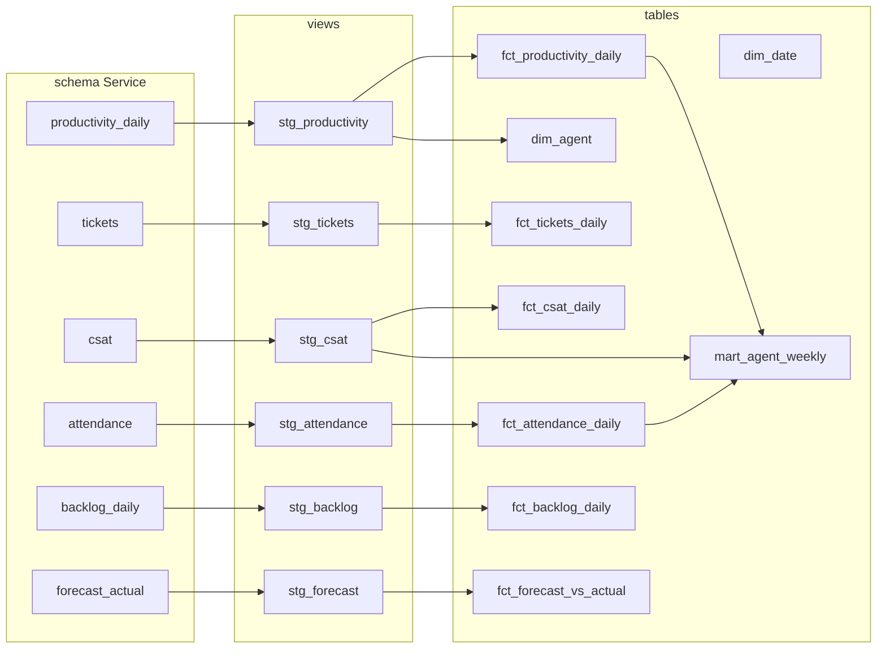

# Workflow

How data moves through the pipeline, from the source systems to the dashboard. All diagrams are Mermaid and render on GitHub.

## 1. End to end

## 2. Daily schedule (Prefect flow, 07:00 Asia/Ho_Chi_Minh)

`dashboard` and `lark` run in parallel. A failed task retries twice (10 minute delay), then posts to the Lark webhook; tasks downstream of a failure do not run. The database load is skipped when an earlier stage failed, so a bad day never overwrites good data. The same stages can be run by hand with `python main.py --module <name>`.

## 3. How one dashboard report is loaded

Everything from step E to the commit is one transaction. Rows older than the window are never touched, which is how years of history survive a daily run. Lark sources are full snapshots and use truncate and reload instead.

## 4. Backfill

If a chunk fails (expired session, network), the run stops for that report. Running the same command again continues from the first unfinished chunk.

## 5. dbt layers

